<div align="center">

  <!-- Header Banner -->
  

  <!-- Interactive AI Agent Terminal Card -->
  

  <br/><br/>

  <!-- Social Badges -->
  <p align="center">
    <a href="https://linkedin.com/in/adeeshachathurmina" target="_blank">
      
    </a>
    <a href="mailto:adeeshachathurmina@gmail.com">
      
    </a>
    <a href="https://github.com/adeeshachathurmina-ux">
      
    </a>
  </p>

</div>

---

### 🧠 Engineering Philosophy & Focus

```yaml
Discipline: Full-Stack Artificial Intelligence & Data Science
Core Architectures: Explainable AI, Agentic RAG Systems, Multi-Agent Reasoning
Tech Stack Spectrum: Python (PyTorch/Sklearn/Streamlit), TypeScript (Next.js/React), Java, R
Location: Sri Lanka 🇱🇰
Mission: "Designing intelligent software that is computationally powerful yet human-intuitive."
```

- 🔭 **Current Focus:** Developing production-grade Agentic RAG workflows, Explainable ML models, and interactive full-stack AI dashboards.
- 💡 **Research Interests:** Transparent machine learning models, domain-specific NLP, and intelligent decision-support systems.
- 💬 **Collaborate With Me On:** Generative AI solutions, predictive data pipelines, and UI/UX design systems.

---

### 🛠️ Tech Stack & Arsenal

<div align="center">

  **Programming Languages**
  <br/>
  <a href="https://skillicons.dev">
    
  </a>
  <br/><br/>

  **AI, Data Science & Web Frameworks**
  <br/>
  <a href="https://skillicons.dev">
    
  </a>
  <br/><br/>

  **Databases, Cloud & Developer Tools**
  <br/>
  <a href="https://skillicons.dev">
    
  </a>

</div>

---

### 🚀 Highlighted Projects

| Project | Domain | Architecture / Stack | Description |
| :--- | :--- | :--- | :--- |
| 🚗 **[luxcar-intelligence-360](https://github.com/adeeshachathurmina-ux/luxcar-intelligence-360)** | AI & Analytics | `TypeScript` `Next.js` `AI` | Full-stack AI vehicle discovery system with dual-horizon matching & 5-year TCO projections. |
| 🧠 **[studypilot-ai-ultimate](https://github.com/adeeshachathurmina-ux/studypilot-ai-ultimate)** | Generative AI | `Python` `RAG` `AI` | Academic learning platform transforming lecture notes into grounded answers & revision insights. |
| 🌴 **[CeylonPath-R](https://github.com/adeeshachathurmina-ux/CeylonPath-R)** | Data Science | `R` `Shiny` | Explainable tourism recommendation and budget planning system for Sri Lanka. |
| 🌦️ **[sri-lanka-weather-insights](https://github.com/adeeshachathurmina-ux/sri-lanka-weather-insights-dashboard)** | Analytics | `Python` `Streamlit` | Live multi-city weather comparison and meteorological insight dashboard. |
| 🤝 **[skillswap-nexus](https://github.com/adeeshachathurmina-ux/skillswap-nexus)** | Full-Stack | `Next.js` `Tailwind` `Supabase` | Reciprocal skill exchange platform with modern reactive UI and Supabase backend. |

---

### 🐍 Contribution Activity (Snake Eating Commits)

<!-- The retro snake eating contributions animation generated automatically via GitHub Actions -->
<div align="center">
  <picture>
    <source media="(prefers-color-scheme: dark)" srcset="https://raw.githubusercontent.com/adeeshachathurmina-ux/adeeshachathurmina-ux/output/github-contribution-grid-snake-dark.svg">
    <source media="(prefers-color-scheme: light)" srcset="https://raw.githubusercontent.com/adeeshachathurmina-ux/adeeshachathurmina-ux/output/github-contribution-grid-snake.svg">
    
  </picture>
</div>

---

### 📊 GitHub Analytics & Streaks

<div align="center">

  <!-- Overall GitHub Stats -->
  <a href="https://github.com/anuraghazra/github-readme-stats">
    
  </a>
  <br/><br/>

  <!-- Top Languages & Streak Stats -->
  <a href="https://github.com/anuraghazra/github-readme-stats">
    
  </a>
  <a href="https://github.com/DenverCoder1/github-readme-streak-stats">
    
  </a>

</div>

---

### 🏆 GitHub Trophies

<div align="center">
  
</div>

---

<div align="center">

  <!-- Profile Visitor Counter -->
  

  <br/><br/>

  <!-- Footer Banner -->
  

</div>
